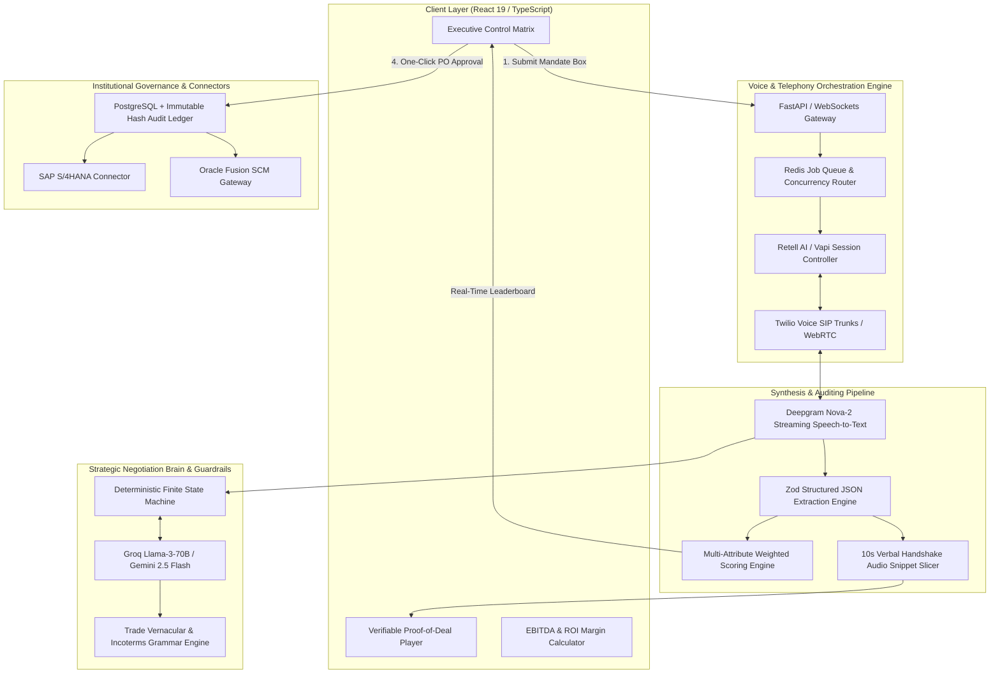

<div align="center">

# 🎙️ VyapaarVoice AI
### Autonomous Voice Intelligence for High-Velocity B2B Commodity Procurement

[](https://opensource.org/licenses/MIT)
[](#technical-innovations--guardrails)
[](#system-architecture--tech-stack)
[](#system-architecture--tech-stack)
[](#team--acknowledgements)

<br/>

> **"Turn 100 Phone Calls into 1 Optimal, Binding Deal in Under 10 Minutes."**  
> *An autonomous voice-intelligence layer that calls 100+ suppliers concurrently, negotiates within strict mathematical ZOPA boundaries, and synthesizes ranked options with cryptographic audio proof for 1-click executive sign-off.*

<br/>

[🚀 **Live Demo Application**](https://ais-dev-4sccfdgu2654naa64pir5r-489100929748.asia-southeast1.run.app) • [📹 **Watch 3-Min Video Pitch**](#) • [📑 **View Pitch Deck & PRD**](#) • [🔬 **Interactive Sourcing Matrix**](#)

---

</div>

<br/>

## 🎯 Executive Summary & Problem vs. Solution

### The Multi-Billion Dollar Procurement Blindspot
In bulk raw material procurement (polymers, hot-rolled steel coil, oleochemicals, agricultural bulk), **price discovery is broken**. A typical corporate buyer or commodity trader spends **6+ hours a day** on manual phone calls. Because of human bandwidth constraints:
- Desks only have time to dial **3 to 5 familiar brokers**.
- Brokers exploit information asymmetry, enforcing artificial pricing floors and fat broker commissions.
- Quotes received via phone call lack structured audit trails, forcing tedious email chains and delayed approvals.
- High-velocity market fluctuations are missed, resulting in **2%–5% margin leakages** on nine-figure annual spend.

### The VyapaarVoice Paradigm Shift

| Sourcing Dimension | Traditional B2B Phone Procurement | VyapaarVoice AI Autonomous Engine |
| :--- | :--- | :--- |
| **Outreach Capacity** | 3–5 phone calls / day per trader | **100 concurrent telephone negotiations in parallel** |
| **Market Depth** | Narrow broker cartel sample | **100% full vendor roster clearing price discovery** |
| **Cycle Settle Time** | 2 to 4 business days | **Under 10 minutes from mandate to signed contract** |
| **Bargaining Discipline** | Emotional, inconsistent trader fatigue | **Deterministic FSM: strictly bounded to $P_T$ and $P_W$ ceilings** |
| **Auditing & Compliance** | Unrecorded phone calls; subjective notes | **Cryptographic SHA-256 hash & isolated 10s audio proof snippet** |
| **ERP Dispatch** | Manual data entry into SAP/Oracle (days) | **1-Click automated PO release via bi-directional webhook** |

> 💰 **Direct Financial Alpha:** On an enterprise with **$25M** annual raw material procurement, a verified **2.5%** basis discount capture recovers **+$625,000 net EBITDA annually**, while eliminating **+2,700 hours** of manual buyer telephone toil.

---

## 🔁 The Core Deal Cycle (User Flow)

```
 ┌──────────────────────┐       ┌──────────────────────┐       ┌──────────────────────┐
 │  1. DEFINE MANDATE   │       │ 2. 100-CHANNEL BLITZ │       │  3. DEAL SYNTHESIS   │
 │ • Set Target Price   │ ────> │ • Concurrent Calling │ ────> │ • Deepgram Stream    │
 │ • Walk-Away Ceiling  │       │ • Trade Vernacular   │       │ • Zod JSON Schemas   │
 │ • Ingest Supplier CSV│       │ • Human Filler Cadence│      │ • Multi-Factor Score │
 └──────────────────────┘       └──────────────────────┘       └──────────────────────┘
                                                                           │
                                                                           ▼
 ┌──────────────────────┐       ┌──────────────────────┐       ┌──────────────────────┐
 │  5. ERP INTEGRATION  │       │  4. EXECUTIVE AUDIT  │       │   LEADERBOARD RANK   │
 │ • Dispatch PO to SAP │ <──── │ • Audition 10s Audio │ <──── │ • Rank #1: Apex      │
 │ • Trigger Webhooks   │       │ • Verify Hash Audit  │       │ • Rank #2: PolyChem  │
 │ • Lock Legal Binding │       │ • 1-Click Approval   │       │ • Rank #3: Global    │
 └──────────────────────┘       └──────────────────────┘       └──────────────────────┘
```

1. **The Deal Box (Mandate Input):**  
   The procurement director enters raw material requirements (e.g., *50 Tons Grade A Polypropylene*), target anchor price ($P_T = \$1,100/\text{T}$), walk-away ceiling ($P_W = \$1,250/\text{T}$), delivery deadlines, and permitted payment terms (Net 30, LC at sight).
2. **The 100-Channel Voice Blitz:**  
   VyapaarVoice triggers concurrent outbound SIP trunks via Twilio and Retell AI, executing parallel negotiation runs across 100 vetted supplier sales desks simultaneously.
3. **Deal Synthesis & Zod Extraction:**  
   Dual-channel audio streams are transcribed in real-time. Call transcripts are parsed into validated structured JSON models (`offered_price`, `payment_terms`, `lead_time`, `sentiment`, `proof_timestamp`).
4. **Executive 1-Click Sign-Off:**  
   The Chief Procurement Officer reviews the top 3 ranked offers, clicks to audition the isolated **10-second verbal handshake audio snippet**, and approves the deal.
5. **Deterministic PO Execution:**  
   VyapaarVoice signs the purchase order specifications with an immutable SHA-256 hash and immediately dispatches the purchase order to SAP S/4HANA or Oracle Fusion SCM.

---

## 🏗️ System Architecture & Tech Stack



### Full Technology Stack Breakdown

| Layer | Technologies & Tools | Purpose |
| :--- | :--- | :--- |
| **Frontend UI** | **React 19, TypeScript, Tailwind CSS v4, Motion (Framer Motion v12)** | Ultra-dark cyber-industrial executive dashboard, magnetic cursor, live telemetry |
| **Audio Synthesis** | **HTML5 Web Audio API, Canvas Confetti** | Real-time browser telephony simulation, frequency waveform visualizers, audio player |
| **Telephony & SIP** | **Twilio Voice, Plivo, WebRTC, SIP Trunks** | High-concurrency outbound telephony dialing up to 100 simultaneous endpoints |
| **Voice Agent Engine** | **Retell AI, Deepgram Nova-2, ElevenLabs Flash TTS** | Sub-800ms end-to-end voice latency, dual-channel transcription, human conversational cadence |
| **Reasoning & FSM** | **Groq Llama-3-70B-Versatile, Google GenAI SDK** | High-speed inference ($<350\text{ms}$), trade dialect fluency, objection handling |
| **Data Validation** | **Zod, JSON Schema Draft-07** | Strict typed extraction of price, delivery dates, payment terms, and sentiment |
| **Persistence & Audit** | **PostgreSQL, Redis Streams, SHA-256 Hashes** | Concurrency queuing, real-time leaderboard states, immutable audit log verification |

---

## 🛡️ Technical Innovations & Guardrails

### 1. Sub-800ms Real-Time Audio Latency Budget
Conversational bargaining collapses if latency feels robotic. VyapaarVoice enforces an **800ms End-to-End Latency Ceiling**:

$$\text{Total Turn Latency} = \underbrace{t_{\text{ASR}}}_{\le 150\text{ms}} + \underbrace{t_{\text{Network}}}_{\le 80\text{ms}} + \underbrace{t_{\text{LLM}}}_{\le 320\text{ms}} + \underbrace{t_{\text{TTS}}}_{\le 200\text{ms}} \approx \mathbf{750\text{ms}}$$

- **Dynamic Filler Audio Injection:** If LLM inference exceeds $400\text{ms}$ due to complex volume calculations, the audio stream immediately injects contextual human conversational fillers (*"Right, let me check our quarterly allocation...", "Understood, checking that mill rate..."*), preventing awkward silence.
- **Smart Turn Interruption:** Immediate barge-in detection allows suppliers to interrupt counter-offers naturally.

---

### 2. Deterministic Negotiation Brain & ZOPA Guardrails
Unlike generic chatbots that hallucinate commitments, VyapaarVoice isolates the LLM inside a **Hard-Bounded State Machine (FSM)**:

```
                      [STATE 0: OPENING]
                      Establish Target Anchor P_T
                                │
               ┌────────────────┴────────────────┐
               ▼                                 ▼
      Supplier Quote <= P_T              Supplier Quote > P_T
               │                                 │
               ▼                                 ▼
       [STATE 1: ACCEPT]             [STATE 2: TRADE CONCESSIONS]
       Lock Terms & Record           Counter-offer Midpoint P_M1
                                     Leverage: Volume or Net 30 Terms
                                                 │
                                 ┌───────────────┴───────────────┐
                                 ▼                               ▼
                         Supplier Accepts                Supplier Rejects
                                 │                               │
                                 ▼                               ▼
                         [STATE 1: ACCEPT]           [STATE 3: FINAL ANCHOR P_W]
                         Lock Terms & Record         Offer Non-Negotiable Ceiling P_W
                                                                 │
                                                 ┌───────────────┴───────────────┐
                                                 ▼                               ▼
                                         Supplier Accepts                Supplier Rejects
                                                 │                               │
                                                 ▼                               ▼
                                         [STATE 1: ACCEPT]           [STATE 4: TERMINATE]
                                         Lock Terms & Record         Polite Walk-Away
```

- **Mathematical Price Ceiling ($P_W$):** The agent runtime contains an immutable code assertion:
  $$\forall \text{ Offers } P_{\text{committed}} \le P_W$$
  Any generated token attempting to commit above $P_W$ is intercepted at the tool-call parser and automatically clamped to $P_W$ or gracefully terminated.
- **Statutory Non-Binding Disclaimer:** The agent explicitly qualifies quotes with legal disclaimers: *"This rate is registered for board pre-approval and constitutes a formal PO upon executive confirmation."*

---

### 3. Multi-Attribute Weighted Scoring Formula ($S_i$)
Procurement decisions should **never be price-only**. A supplier with the lowest nominal price may cause catastrophic plant shutdowns if lead times are excessive. VyapaarVoice evaluates offers using a **composite multi-factor scoring function**:

$$S_i = w_p \cdot \left( \frac{P_{\min}}{P_i} \right) + w_t \cdot \left( \frac{T_{\text{target}}}{T_i} \right) + w_r \cdot \left( \frac{R_i}{10} \right) + w_s \cdot S_i^{\text{sentiment}}$$

Where:
- $S_i \in [0.0, 1.0]$: Normalized Composite Score for supplier $i$.
- $P_i, P_{\min}$: Offered unit price vs. lowest price across all campaign respondents.
- $T_i, T_{\text{target}}$: Quoted delivery lead time (days) vs. executive deadline.
- $R_i \in [1, 10]$: Historical supplier reliability rating (on-time delivery record).
- $S_i^{\text{sentiment}} \in \{1.0 \text{ [Flexible]}, 0.7 \text{ [Neutral]}, 0.4 \text{ [Rigid]}\}$.
- **Calibrated Default Weights:**
  - $w_p = 0.50$ (Price Competitiveness)
  - $w_t = 0.25$ (Delivery Speed & Supply Chain Certainty)
  - $w_r = 0.15$ (Historical Vendor Quality & Spec Tolerance)
  - $w_s = 0.10$ (Commercial Flexibility & Relationship Sentiment)

$$\sum (w_p + w_t + w_r + w_s) = 1.00$$

---

## 💻 Local Development & Quickstart

Follow these steps to run the complete interactive landing page and simulation console locally.

### Prerequisites
- **Node.js:** v18.0.0 or higher ([Download](https://nodejs.org/))
- **npm** (or `pnpm` / `yarn`)

### 1. Clone the Repository
```bash
git clone https://github.com/your-username/vyapaarvoice-ai.git
cd vyapaarvoice-ai
```

### 2. Install Dependencies
```bash
npm install
```

### 3. Configure Environment Variables
Create a local environment configuration file:
```bash
cp .env.example .env.local
```

Sample configuration keys:
```env
# Google Gemini API Key (Required for AI Studio build runs)
GEMINI_API_KEY="your-gemini-api-key"

# Application Deployment URL
APP_URL="http://localhost:3000"

# Optional: Real Telephony & Voice Pipeline Integrations
# RETELL_API_KEY="your-retell-ai-key"
# DEEPGRAM_API_KEY="your-deepgram-api-key"
# TWILIO_ACCOUNT_SID="your-twilio-sid"
# TWILIO_AUTH_TOKEN="your-twilio-token"
```

### 4. Launch the Development Server
```bash
npm run dev
```

Visit **`http://localhost:3000`** in your browser.

### 5. Production Build & Verification
```bash
# Type-check and lint codebase
npm run lint

# Build production bundle
npm run build

# Preview production build locally
npm run preview
```

---

## 🗺️ Roadmap: Hackathon MVP vs. Enterprise Roadmap

```
┌──────────────────────────────────────────────────────────────────────────────┐
│                    FEATURE MATRIX: HACKATHON MVP VS ROADMAP                  │
├──────────────────────────────────────┬───────────────────────────────────────┤
│ FEATURE / MODULE                     │ HACKATHON MVP        ENTERPRISE 2026  │
├──────────────────────────────────────┼───────────────────────────────────────┤
│ Outbound Voice Blitz Simulator       │  ✅ Complete          ✅ Production   │
│ Target & Walk-away ZOPA Sliders      │  ✅ Complete          ✅ Production   │
│ Live Acoustic Waveform Radar Core    │  ✅ Complete          ✅ Production   │
│ Web Audio Handshake Audio Audition   │  ✅ Complete          ✅ Production   │
│ Dynamic Multi-Factor Deal Leaderboard│  ✅ Complete          ✅ Production   │
│ Interactive EBITDA ROI Calculator    │  ✅ Complete          ✅ Production   │
│ Bi-Directional ERP Connectors        │  ⚡ UI & Webhooks     ✅ Native SAP   │
│ Multi-Round Dutch Reverse Auctions   │  🔄 Phase 2           ✅ Production   │
│ Buyer Custom Voice Cloning           │  🔄 Phase 2           ✅ Production   │
│ Multi-Lingual Dialects (Hindi, Mand.)│  🔄 Phase 2           ✅ Production   │
│ Automated PDF Contract Generation    │  🔄 Phase 2           ✅ Production   │
└──────────────────────────────────────┴───────────────────────────────────────┘
```

---

## 👥 The Team & Acknowledgements

Built with passion for the **Global AI Build Hackathon 2026**:

- **Dev Marvania** — *Lead Architect, Full-Stack & Voice Systems Engineer*  
  GitHub: [@devmarvania](https://github.com/devmarvania) • Email: `dev.marvania@gmail.com`

### Acknowledgements & Special Thanks
- **Deepgram** for high-speed streaming Nova-2 speech-to-text.
- **Groq** for ultra-low latency Llama-3 inference pipelines.
- **ElevenLabs** for human conversational voice synthesis.
- **Tailwind Labs** & **Framer Motion** for state-of-the-art web interaction primitives.

---

<div align="center">

**Distributed under the MIT License.**  
*© 2025–2026 VyapaarVoice AI Systems Inc. Enterprise Commodity Sourcing & Execution.*

</div>
